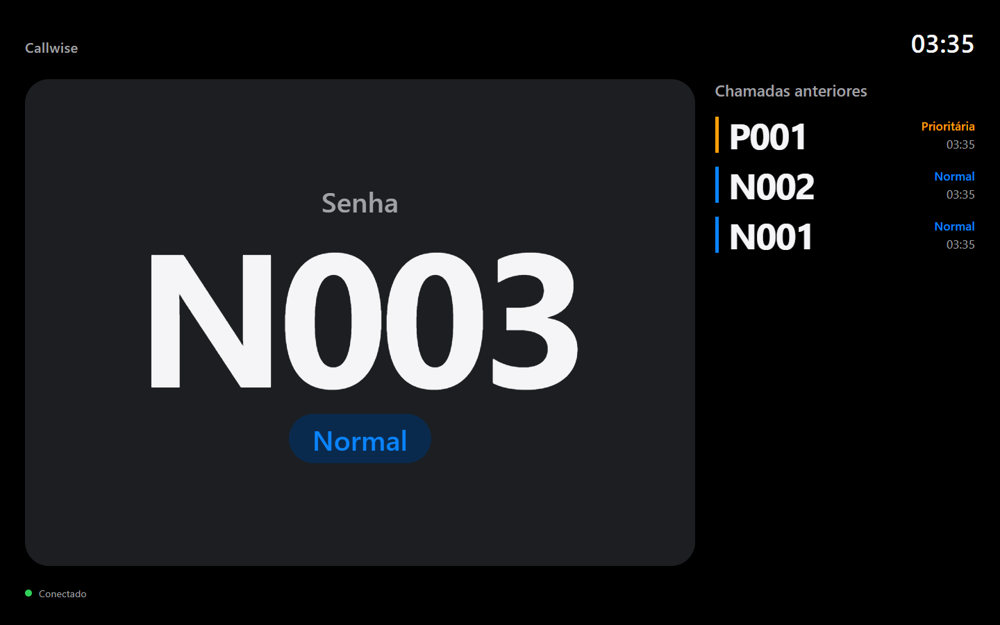
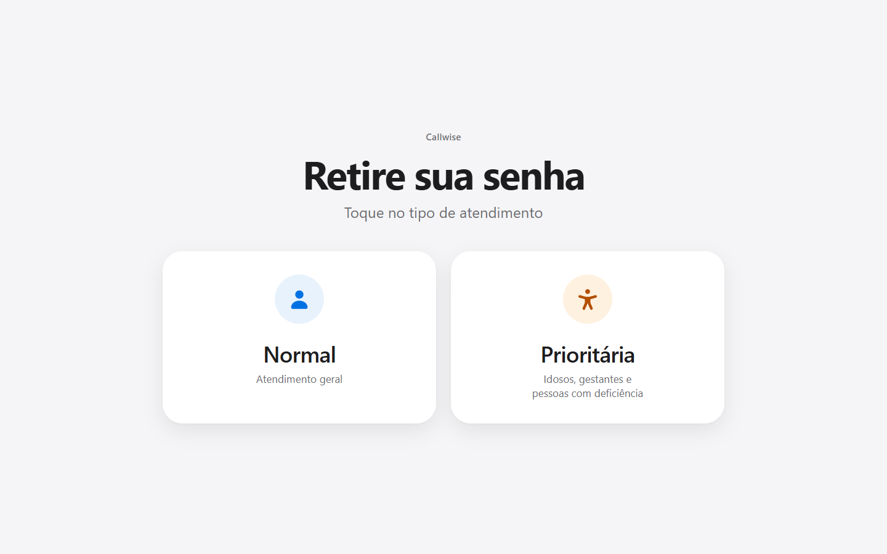
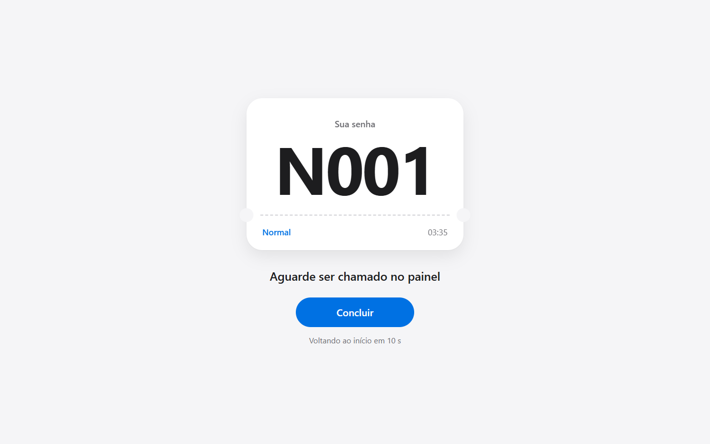
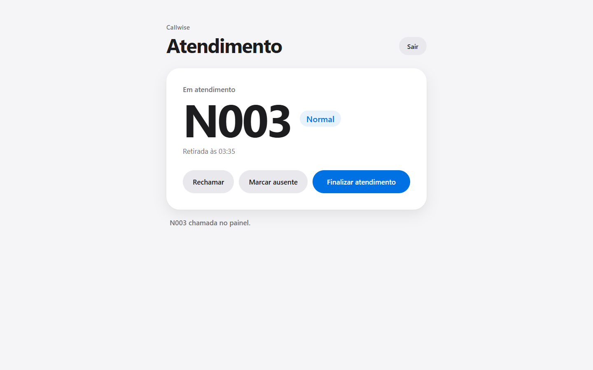
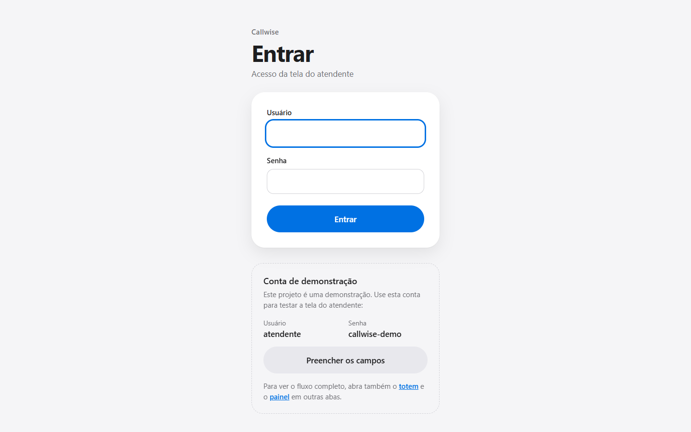
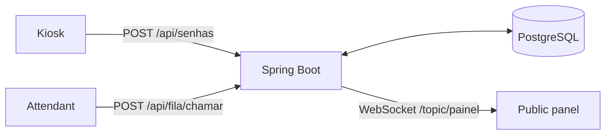

# Callwise

Queue management system with a real-time display panel. Customers take a ticket at the kiosk, the attendant calls the next one, and the public panel shows it instantly with a sound alert, without reloading the page.




## Live demo

**https://callwise-4hun.onrender.com**

To see the whole flow, open the three screens in separate tabs (or on separate devices):

| Screen | Link | What to do |
|---|---|---|
| Public panel | [/painel](https://callwise-4hun.onrender.com/painel/index.html) | Click **Ativar painel** to allow the sound |
| Kiosk | [/totem](https://callwise-4hun.onrender.com/totem/index.html) | Take a regular or priority ticket |
| Attendant | [/login](https://callwise-4hun.onrender.com/login/index.html) | Log in with the demo account and call the ticket |

**Demo account:** user `atendente`, password `callwise-demo`. The login page also has a button that fills them in.

> The demo runs on a free plan that sleeps after 15 minutes without visits. The first request after that can take up to 2 minutes while the server starts; after that it is fast.

## Screenshots

| Kiosk | Issued ticket |
|---|---|
|  |  |

| Attendant | Login |
|---|---|
|  |  |

The panel at the top shows the queue rule at work: `N001` and `N002` were called, then the priority ticket `P001`, and now `N003`.

## Features

- [x] **Kiosk:** take a regular or priority ticket. Codes are short and restart every day (`N001`, `P001`...)
- [x] **Priority queue:** 2 regular tickets, then 1 priority, so priority customers are served sooner without blocking the regular line
- [x] **Attendant screen:** call the next ticket, recall it, finish the service or mark the customer as absent
- [x] **Real-time public panel:** current ticket, last 5 calls, clock, connection indicator and a chime on each call, over WebSocket
- [x] **Attendant login** with Spring Security and a custom login page
- [x] **Consistent API errors:** every error returns the same JSON with a clear message
- [x] **Light and dark themes** on the kiosk, attendant and login screens
- [x] **Online deployment** with Docker on Render and PostgreSQL on Neon

## How it works



1. The customer chooses **Regular** or **Priority** at the kiosk and receives a code, for example `N004`.
2. The attendant clicks **Chamar próxima** (call next). The backend picks the next ticket using the queue rule and marks it as called.
3. The backend publishes the ticket to the `/topic/painel` topic. Every open panel receives it at the same moment, shows it in large type and plays a chime.
4. The attendant then **finishes** the service, **recalls** the ticket (it appears on the panel again) or marks the customer as **absent**.

**Queue rule:** if a priority ticket is waiting and the last two calls were regular tickets, the next call is the priority one. Priority tickets are also called when no regular ticket is waiting. Inside each type, the oldest ticket goes first. More details and a step-by-step example are in [docs/ARCHITECTURE.md](docs/ARCHITECTURE.md#queue-rule).

## Tech stack

| Layer | Technologies |
|---|---|
| Backend | Java 21, Spring Boot 4.1 (Web MVC, Data JPA, Validation, Security, WebSocket), Lombok |
| Real time | STOMP over WebSocket with SockJS, Spring simple broker |
| Database | PostgreSQL 16, Hibernate |
| Front-end | HTML, CSS and JavaScript, no framework and no build step. Web Audio API for the chime |
| Tests | JUnit 5, Mockito, MockMvc, Spring Security Test |
| Infrastructure | Docker (multi-stage image), Docker Compose, Render, Neon |

## Project structure

```
callwise-spring-boot
├── src/main/java/com/andynn/callwise
│   ├── config/        Security and WebSocket configuration
│   ├── controller/    REST endpoints (tickets and queue)
│   ├── dto/           Request and response records
│   ├── exception/     Global error handler
│   ├── model/         Ticket entity, type and status
│   ├── repository/    Spring Data repository
│   └── service/       Ticket issuing, queue operations, queue rule, panel announcements
├── src/main/resources
│   ├── application.properties
│   └── static/        totem, painel, atendente and login screens
├── src/test/java/...  35 automated tests
├── docs/              Architecture, API, deploy and technical decisions
├── Dockerfile         Multi-stage image used in production
└── docker-compose.yml Local PostgreSQL
```

The code and the screens use Portuguese domain terms (*senha* = ticket, *fila* = queue, *atendente* = attendant, *painel* = panel, *totem* = kiosk). The full glossary is in [docs/ARCHITECTURE.md](docs/ARCHITECTURE.md#glossary).

## API

| Method | Endpoint | Access | Description |
|---|---|---|---|
| `POST` | `/api/senhas` | Public | Issue a ticket (`{"tipo": "NORMAL"}` or `"PRIORITARIA"`) |
| `POST` | `/api/fila/chamar` | Attendant | Call the next ticket and announce it on the panel (`204` if the queue is empty) |
| `POST` | `/api/fila/{id}/rechamar` | Attendant | Recall the ticket on the panel |
| `POST` | `/api/fila/{id}/finalizar` | Attendant | Finish the service |
| `POST` | `/api/fila/{id}/ausente` | Attendant | Mark the customer as absent |
| `WS` | `/ws` → `/topic/painel` | Public | Receive every call in real time (SockJS + STOMP) |

Every error returns the same body:

```json
{ "status": 409, "mensagem": "Esta senha não está em atendimento", "caminho": "/api/fila/7/finalizar" }
```

Full reference with examples: [docs/API.md](docs/API.md).

## How to run locally

**Requirements:** Java 21 and Docker.

1. **Create the environment file** from the template:

   ```bash
   cp .env.example .env              # Linux / macOS / Git Bash
   Copy-Item .env.example .env       # Windows PowerShell
   ```

   Then edit `.env` and set your own values:

   | Variable | Description |
   |---|---|
   | `DB_NAME`, `DB_USER`, `DB_PASSWORD` | Local database name and credentials |
   | `DB_PORT` | Port of the local database (`5433`, so it does not clash with a PostgreSQL already installed on `5432`) |
   | `ATENDENTE_USUARIO`, `ATENDENTE_SENHA` | Login of the attendant screen. Use `atendente` / `callwise-demo` if you want the demo button of the login page to work |

   `.env` is ignored by Git, so your passwords stay on your machine.

2. **Start PostgreSQL:**

   ```bash
   docker compose up -d
   ```

3. **Run the application:**

   ```bash
   ./mvnw spring-boot:run        # Linux / macOS / Git Bash
   .\mvnw.cmd spring-boot:run    # Windows PowerShell
   ```

4. **Open the screens:**

   - Kiosk: http://localhost:8080/totem/index.html
   - Panel: http://localhost:8080/painel/index.html
   - Attendant: http://localhost:8080/login/index.html

The tables are created automatically on the first start.

### Running the tests

```bash
./mvnw test
```

The suite has 35 tests. One of them starts the whole application, so the local PostgreSQL must be running (`docker compose up -d`).

### Running with Docker

```bash
docker build -t callwise .
docker run --rm -p 8080:8080 --env-file .env \
  -e DB_URL=jdbc:postgresql://host.docker.internal:5433/callwise \
  callwise
```

Inside the container, `localhost` is the container itself, so `DB_URL` points to `host.docker.internal` to reach the database on your computer. More in [docs/DEPLOY.md](docs/DEPLOY.md#running-the-image-locally).

## Deploy

The demo runs on **Render** (free web service built from the `Dockerfile`) with the database on **Neon** (free PostgreSQL 16), both in the US East region. Every merge to `main` deploys a new version automatically.

The production settings come from environment variables: `PORT` (set by Render), `DB_URL`, `DB_USER`, `DB_PASSWORD`, `ATENDENTE_USUARIO` and `ATENDENTE_SENHA`.

Step-by-step guide and troubleshooting: [docs/DEPLOY.md](docs/DEPLOY.md).

## Technical decisions

Some of the main choices (all explained in [docs/DECISIONS.md](docs/DECISIONS.md)):

- **The queue rule is a pure component** (`RegraFila`) with no database access, so the most important rule of the system is covered by fast unit tests.
- **WebSocket with STOMP and SockJS** instead of polling: every panel receives a call at the same moment, and SockJS keeps it working on networks that block raw WebSockets.
- **The panel is notified after the transaction commits**, so it never shows a ticket whose change failed to save.
- **One JSON error format** for the whole API, with clear messages for the screens and no internal details in unexpected errors.
- **Daily numbering protected by a unique constraint**, so a duplicated code can never be stored.
- **Brasília time in the JVM and in Hibernate**, because "today" decides which tickets are in the queue and containers run in UTC.
- **Render + Neon** to keep the demo online for free: Render's own free database expires after 30 days.

Known limitations of the current version are listed at the end of [docs/DECISIONS.md](docs/DECISIONS.md#known-limitations).

## Documentation

| Document | Contents |
|---|---|
| [ARCHITECTURE.md](docs/ARCHITECTURE.md) | Components, layers, data model, ticket lifecycle, queue rule, real-time flow, security, tests |
| [API.md](docs/API.md) | Every endpoint with request and response examples, error format, WebSocket |
| [DEPLOY.md](docs/DEPLOY.md) | Docker image, environment variables, Neon and Render setup, troubleshooting |
| [DECISIONS.md](docs/DECISIONS.md) | Technical decisions, trade-offs and known limitations |

## Roadmap

- [ ] Versioned database migrations with Flyway
- [ ] Multiple service counters, each with its own attendant
- [ ] Ticket with a QR code to follow the queue on the phone
- [ ] Daily report: tickets issued, waiting time and service time
- [ ] More queue types (for example, front desk and cafeteria)
- [ ] Synthesized voice reading the ticket on the panel
- [ ] CSRF protection on the attendant API

## Author

**Anderson Melo do Nascimento** · [GitHub](https://github.com/andynnnfw)
