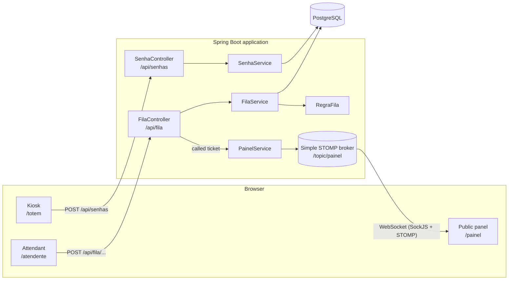
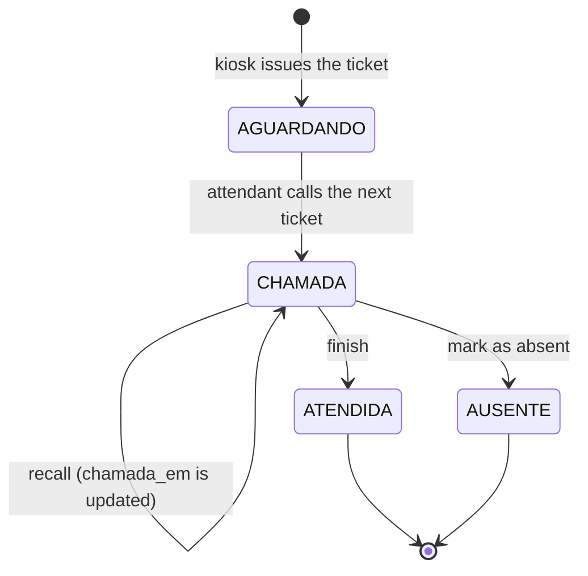
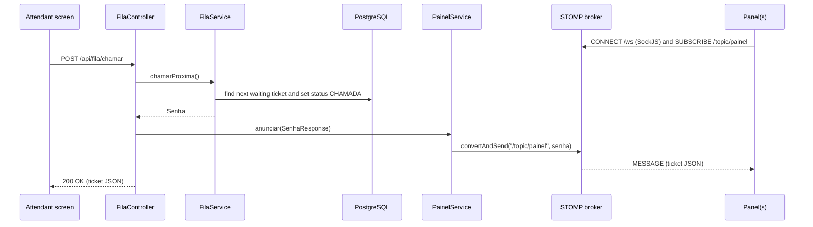

# Architecture

This document explains how Callwise is organized, how a ticket moves through the system and how the public panel is updated in real time.

- [Overview](#overview)
- [Glossary](#glossary)
- [Components](#components)
- [Backend layers](#backend-layers)
- [Data model](#data-model)
- [Ticket lifecycle](#ticket-lifecycle)
- [Queue rule](#queue-rule)
- [Real-time panel](#real-time-panel)
- [Security](#security)
- [Front-end screens](#front-end-screens)
- [Configuration](#configuration)
- [Tests](#tests)

## Overview

Callwise is a single Spring Boot application that serves both the REST API and the four static web screens. PostgreSQL stores the tickets, and a STOMP message broker running inside the application pushes every call to the public panel through a WebSocket.



## Glossary

The code and the screens are written in Portuguese. These are the domain terms used across the project:

| Portuguese | English | Meaning |
|---|---|---|
| Senha | Ticket | The number a customer takes at the kiosk (for example `N001`) |
| Fila | Queue | The set of tickets waiting to be called |
| Totem | Kiosk | Screen where the customer takes a ticket |
| Atendente | Attendant | Staff member who calls and serves tickets |
| Painel | Panel | Public display (usually a TV) that shows the called ticket |
| Normal / Prioritária | Regular / Priority | Ticket types. Priority is for elderly people, pregnant women and people with disabilities |
| Chamar / Rechamar | Call / Recall | Call the next ticket / call the current ticket again |
| Finalizar / Ausente | Finish / Absent | End the service / the customer did not show up |

## Components

| Component | Responsibility |
|---|---|
| **Kiosk** (`static/totem`) | Lets the customer choose the ticket type and shows the issued ticket. Public. |
| **Attendant screen** (`static/atendente`) | Calls the next ticket and recalls, finishes or marks the current one as absent. Requires login. |
| **Public panel** (`static/painel`) | Shows the current ticket, the last calls and a clock, and plays a chime on each call. Public. |
| **Login page** (`static/login`) | Custom form for Spring Security, with a demo account box. |
| **REST API** (`controller`) | Endpoints used by the kiosk and the attendant screen. See [API.md](API.md). |
| **WebSocket broker** (`config/WebSocketConfig`) | In-memory STOMP broker that delivers calls to every open panel. |
| **PostgreSQL** | Stores the tickets of every day. |

## Backend layers

```
com.andynn.callwise
├── config/       SecurityConfig, WebSocketConfig
├── controller/   SenhaController, FilaController
├── dto/          EmitirSenhaRequest, SenhaResponse, ErroResponse
├── exception/    GlobalExceptionHandler
├── model/        Senha, TipoSenha, StatusSenha
├── repository/   SenhaRepository
└── service/      SenhaService, FilaService, RegraFila, PainelService
```

- **Controllers** only translate HTTP into service calls and entities into DTOs (`SenhaResponse.de(senha)`). The JPA entity is never returned directly.
- **`SenhaService`** issues tickets: it finds the last number of the day for the type and saves the next one.
- **`FilaService`** holds the queue operations (call, finish, absent, recall) and validates the ticket status before changing it. Business errors are thrown as `ResponseStatusException` (404 and 409).
- **`RegraFila`** is a plain component with no database access that decides which ticket type comes next. Keeping it pure made the rule easy to test in isolation (`RegraFilaTest`).
- **`PainelService`** publishes the called ticket to `/topic/painel` with `SimpMessagingTemplate`. The controller calls it after `chamarProxima` and `rechamar`, so finishing a ticket or marking it absent never reaches the panel.
- **`GlobalExceptionHandler`** turns every API error into the same JSON format (`ErroResponse`). It is scoped to the `controller` package so static pages keep Spring's default behaviour.

## Data model

A single table holds the whole system state.

**Table `senha`**

| Column | Type | Description |
|---|---|---|
| `id` | `bigint` (identity) | Primary key |
| `tipo` | `varchar` (`NORMAL`, `PRIORITARIA`) | Ticket type |
| `numero` | `integer` | Sequential number of the type on that day (1, 2, 3...) |
| `codigo` | `varchar` | Code shown to people: type prefix + three digits (`N001`, `P012`) |
| `status` | `varchar` (`AGUARDANDO`, `CHAMADA`, `ATENDIDA`, `AUSENTE`) | Current status. New tickets start as `AGUARDANDO` |
| `data_emissao` | `date` | Day the ticket was issued. Every queue query filters by today |
| `emitida_em` | `timestamp` | When it was issued |
| `chamada_em` | `timestamp` | When it was last called (updated again on recall) |
| `finalizada_em` | `timestamp` | When it was finished or marked as absent |

**Unique constraint:** `(tipo, data_emissao, numero)`. The numbering restarts every day for each type, and the constraint guarantees that the database never stores two tickets with the same code on the same day.

The schema is created and updated by Hibernate (`spring.jpa.hibernate.ddl-auto=update`). Moving to versioned migrations with Flyway is on the roadmap.

## Ticket lifecycle



- Only a ticket in `CHAMADA` can be recalled, finished or marked as absent. Any other status returns **409 Conflict** with the message `Esta senha não está em atendimento`.
- An unknown id returns **404 Not Found** with `Senha não encontrada`.
- Every state change happens inside a `@Transactional` method, and the change is saved by JPA dirty checking when the transaction commits.

## Queue rule

Priority tickets must be served first, but regular tickets cannot wait forever. Callwise uses a **2 regular : 1 priority** rotation, implemented in `RegraFila.proximoTipo(normaisSeguidas, temNormal, temPrioritaria)`:

1. If no ticket is waiting, nothing is called (the API answers `204 No Content`).
2. If a priority ticket is waiting **and** either two regular tickets were called in a row **or** no regular ticket is waiting, the next one is **priority**.
3. Otherwise, the next one is **regular**.

Inside each type, tickets are called in order of number (oldest first), and only tickets issued **today** are considered.

`normaisSeguidas` is computed by `FilaService` from the last two tickets called today (ordered by `chamada_em`): it counts regular tickets until it finds a priority one. Two is the maximum the rule needs, so the query never reads more than two rows.

**Example** with `N001`, `N002`, `N003`, `N004`, `P001` and `P002` waiting:

| Call | Regular in a row before the call | Called |
|---|---|---|
| 1st | 0 | `N001` |
| 2nd | 1 | `N002` |
| 3rd | 2 | `P001` |
| 4th | 0 | `N003` |
| 5th | 1 | `N004` |
| 6th | 2, and no regular left | `P002` |

## Real-time panel

The panel never polls the server. It opens a WebSocket once and receives each call as it happens.



- **Endpoint:** `/ws`, with SockJS enabled so the panel still works where raw WebSockets are blocked.
- **Broker:** Spring's simple in-memory broker on the `/topic` prefix. It is enough for a single application instance.
- **Payload:** the same `SenhaResponse` JSON returned by the API (`id`, `codigo`, `tipo`, `status`, `emitidaEm`).
- **Recall:** sends the same ticket again. The panel recognizes it by `id`, so it flashes it again instead of adding a duplicate to the history.
- **Reconnection:** the STOMP client reconnects every 3 seconds and the panel shows a connection indicator (`Conectado`, or `Sem conexão com o servidor. Tentando de novo…` while it is offline).

## Security

Spring Security protects the attendant area. Configuration lives in `SecurityConfig`.

| Route | Access |
|---|---|
| `/totem/**`, `/painel/**`, `/login/**`, `/ws/**`, `/error` | Public |
| `POST /api/senhas` | Public (the kiosk has no login) |
| Everything else, including `/atendente/**` and `/api/fila/**` | Authenticated |

- **Form login** with a custom page (`/login/index.html`). The form posts to `/login`, and a successful login always goes to `/atendente/index.html`.
- **Wrong credentials** redirect to `/login/index.html?erro`. **Logout** (`POST /logout`) redirects to `/login/index.html?saiu`.
- **Single attendant user**, defined by the `ATENDENTE_USUARIO` and `ATENDENTE_SENHA` environment variables (`spring.security.user.*`). The password is kept in memory only.
- **Session expired:** when an API call from the attendant screen is redirected to the login page, the screen sends the user to `/login/index.html?expirou`.
- **CSRF protection is disabled.** The reasoning and the trade-off are in [DECISIONS.md](DECISIONS.md#csrf-disabled).

## Front-end screens

The screens are plain HTML, CSS and JavaScript served by Spring Boot from `src/main/resources/static`. There is no build step and no framework.

| Screen | Details |
|---|---|
| **Kiosk** | Two large buttons (Regular / Priority). After issuing, it shows the ticket with its time and goes back to the start after 10 seconds. |
| **Attendant** | Shows "free" or the ticket being served, with Recall, Mark absent and Finish. The current ticket is kept in `localStorage`, so a page refresh does not lose the service in progress. Buttons are disabled while a request runs. |
| **Panel** | Big current ticket, the last 5 calls with time, a clock and a connection indicator. Browsers block sound until the user interacts with the page, so the panel starts with an **Ativar painel** (Activate panel) button; after that, each call plays a two-note chime generated with the Web Audio API (no audio files). |
| **Login** | Custom form with messages for wrong password, logout and expired session, plus a demo account box with a button that fills the fields. |

The kiosk, attendant and login screens follow the system light/dark theme (`prefers-color-scheme`). The panel is always dark, because it is meant for a TV.

The panel loads `sockjs-client` and `@stomp/stompjs` from the jsDelivr CDN.

## Configuration

All settings are in `src/main/resources/application.properties`, and every secret or environment-specific value comes from an environment variable.

| Variable | Used for | Default |
|---|---|---|
| `PORT` | HTTP port (`server.port`) | `8080` |
| `DB_URL` | Full JDBC URL of the database | `jdbc:postgresql://localhost:${DB_PORT}/${DB_NAME}` |
| `DB_PORT` | Local database port, used by the default URL and by Docker Compose | `5433` |
| `DB_NAME` | Local database name, used by the default URL and by Docker Compose | `callwise` |
| `DB_USER` | Database user | none |
| `DB_PASSWORD` | Database password | none |
| `ATENDENTE_USUARIO` | Attendant login | none |
| `ATENDENTE_SENHA` | Attendant password | none |

For local development the variables are read from a `.env` file in the project root (`spring.config.import=optional:file:.env[.properties]`). The same file feeds `docker-compose.yml`. In production they are set in the hosting dashboard (see [DEPLOY.md](DEPLOY.md)).

Other relevant settings:

- `spring.jpa.open-in-view=false`: database access ends with the service transaction, never in the view.
- `spring.jpa.properties.hibernate.jdbc.time_zone=America/Sao_Paulo`: timestamps are written in Brasília time.

## Tests

The project has **35 automated tests** (JUnit 5, Mockito and Spring's MockMvc):

| Class | What it covers |
|---|---|
| `RegraFilaTest` | The 2:1 queue rule in isolation: empty queue, only one type waiting, priority after two regular tickets, priority that arrives in the middle of the rotation |
| `FilaServiceTest` | Call, finish, absent and recall with a mocked repository, including finishing an already finished ticket, marking a waiting ticket as absent (409) and recalling a ticket that does not exist (404) |
| `FilaControllerTest` | That calls and recalls are announced on the panel, and that finishing is not |
| `PainelServiceTest` | That the ticket is sent to `/topic/painel` |
| `SecurityConfigTest` | Public and protected routes, login success and failure, logout |
| `GlobalExceptionHandlerTest` | The JSON error body for 404, 409, validation, invalid JSON, invalid id and unexpected errors |
| `CallwiseApplicationTests` | That the application context starts |

`CallwiseApplicationTests` starts the full application, so it needs the local PostgreSQL running (`docker compose up -d`). The other tests run without a database.
